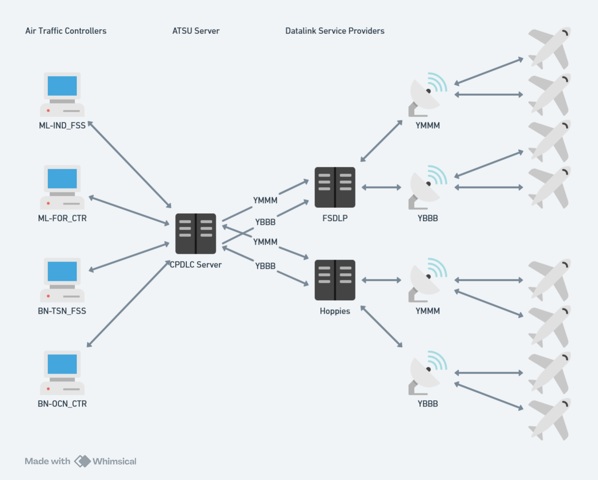

# CPDLC Server



The server maintains one or more connections to upstream ACARS networks (i.e. [Hoppies](https://www.hoppie.nl/acars/)).
Each connection simulates a single air traffic service unit (ATSU), such as Brisbane (YBBB) or Melbourne (YMMM).
The server will relay CPDLC messages to the upstream ACARS network, allowing pilots to connect to a single ATS unit and communicate with all enroute controllers within that unit.

The server also allows for multiple connections upstream ACARS networks, enabling ATC to communicate with aircraft on different ACARS networks (Hoppies, FSDLP, etc.) or aggregate messages across multiple ATSUs.

## Deployment

Deploy your own CPDLC Server instance to DigitalOcean:

[](https://cloud.digitalocean.com/apps/new?repo=https://github.com/YuKitsune/CPDLCPlugin/tree/main)

After deployment, configure the following environment variables in the DigitalOcean dashboard:
- `Acars__0__StationIdentifier`: Your station identifier (e.g., YBBB)
- `Acars__0__AuthenticationCode`: Your Hoppie ACARS authentication code

## Prerequisites

Before running the CPDLC Server, ensure you have:

- [.NET 10.0 SDK](https://dotnet.microsoft.com/download) or later (for local development)
- [Docker](https://www.docker.com/get-started) (for Docker deployment)
- A Hoppies ACARS account and logon code from [hoppie.nl](https://www.hoppie.nl/acars/system/register.html)

## Configuration

The server can be configured using environment variables.
Copy `example.env` to `.env` and update with your settings:

```bash
# Logging
Logging__Level=Information

# ACARS Client Configuration
Acars__0__Type=Hoppie
Acars__0__FlightSimulationNetwork=VATSIM
Acars__0__StationIdentifier=YBBB
Acars__0__Url=http://www.hoppie.nl/acars/system/connect.html
Acars__0__AuthenticationCode=your-hoppie-logon-code
# Reporting interval in minutes of the ADS-C contract requested on CPDLC logon (default: 10)
Acars__0__DefaultAdscReportingInterval=10
# Minutes from the request of a selected ADS-C contract to its end. Then the default contract is requested again (default: 60)
Acars__0__SelectedAdscContractDuration=60

# Handoff Configuration
# How many minutes before the expected transfer time to send the NEXT DATA AUTHORITY message (default: 10)
Handoff__NotificationLeadTime=10

# ADS-C from VATSIM status data
# Make ADS-C reports from the VATSIM status data for aircraft that do not support ADS-C over Hoppie (default: false)
VatsimStatus__Enabled=false
# The URL of the VATSIM status data (default: https://data.vatsim.net/v3/vatsim-data.json)
VatsimStatus__Url=https://data.vatsim.net/v3/vatsim-data.json
# The time between downloads of the VATSIM status data, as hh:mm:ss (default: 00:02:00)
VatsimStatus__PollingInterval=00:02:00
# Also make reports for aircraft that do not have D1 or G1 in Item 10b of the flight plan (default: false)
VatsimStatus__AllowNonEquippedAircraft=false
```

### Multiple ACARS Connections

You can configure multiple ACARS clients by incrementing the index (`Acars__1__`, `Acars__2__`, etc.). This is useful when serving multiple ATSUs (e.g., YBBB and YMMM)

Example configuration for multiple connections:

```bash
# Brisbane FIR
Acars__0__Type=Hoppie
Acars__0__FlightSimulationNetwork=VATSIM
Acars__0__StationIdentifier=YBBB
Acars__0__Url=http://www.hoppie.nl/acars/system/connect.html
Acars__0__AuthenticationCode=your-ybbb-hoppie-code

# Melbourne FIR
Acars__1__Type=Hoppie
Acars__1__FlightSimulationNetwork=VATSIM
Acars__1__StationIdentifier=YMMM
Acars__1__Url=http://www.hoppie.nl/acars/system/connect.html
Acars__1__AuthenticationCode=your-ymmm-hoppie-code
```

:::note
`Hoppie` is currently the only supported ACARS network type.
:::

### ADS-C

When an aircraft logs on with CPDLC, the server requests the default ADS-C contract with the aircraft. When the CPDLC connection ends, the server cancels the contract.

Each ATSU has its own default reporting interval, set with `Acars__<index>__DefaultAdscReportingInterval`. Controllers can read this value.

A controller can select a different reporting interval for an aircraft. The selected contract ends `Acars__<index>__SelectedAdscContractDuration` minutes after the server sends the request. Then the server requests the default contract again. A controller can also go back to the default contract at any time.

The aircraft does not acknowledge a request. The first report after a request accepts it. If the aircraft rejects a selected contract, the server requests the default contract again. If the aircraft rejects the default contract, the server does not send it again.

The server keeps the latest report for each aircraft. When a controller connects, the plugin loads these reports, so that the controller sees the ADS-C tracks immediately.

The ADS-C page of the dashboard (`/adsc`) shows all the contracts and their states, the source of the latest report for each aircraft, and a log of all the ADS-C messages that the server sent and received.

The minimum reporting interval is 2 minutes.

### ADS-C from VATSIM Status Data

Not all aircraft support ADS-C over Hoppie's network. When `VatsimStatus__Enabled` is `true`, the server makes ADS-C reports from the [VATSIM status data](https://data.vatsim.net/v3/vatsim-data.json) for these aircraft.

The server downloads the VATSIM status data at the interval set by `VatsimStatus__PollingInterval` (2 minutes by default). Then it makes a report for each aircraft that has a contract, when all of these conditions are true:

- The contract is not rejected.
- The contract needs a report: a demand request was sent, or a periodic report is due.
- There is no report from Hoppie, or the latest report from Hoppie is more than two reporting intervals late.
- The aircraft is in the VATSIM status data.
- The aircraft has `D1` or `G1` in Item 10b of the flight plan, or `VatsimStatus__AllowNonEquippedAircraft` is `true`. An aircraft without a flight plan is not equipped.

A report from the VATSIM status data accepts the contract, the same as a report from the aircraft. The time of the report is the time that VATSIM last updated the position of the aircraft.

The server continues to send all the requests to the aircraft through Hoppie. A report from Hoppie always replaces a report from the VATSIM status data, and stops the VATSIM reports. If the Hoppie reports stop for more than two reporting intervals, the VATSIM reports start again. A demand request without a periodic contract has no reporting interval. Thus, after a report from Hoppie, the server does not use the VATSIM status data for a demand-only contract.

Each report has a source: `Hoppie` or `VATSIM`.

## Running

### Docker

```bash
docker-compose up
```

The server will be available at `http://localhost:5272`.

### Local Development

```bash
dotnet run --project source/CPDLCServer/CPDLCServer.csproj
```

The server will start on `http://localhost:5261`.
