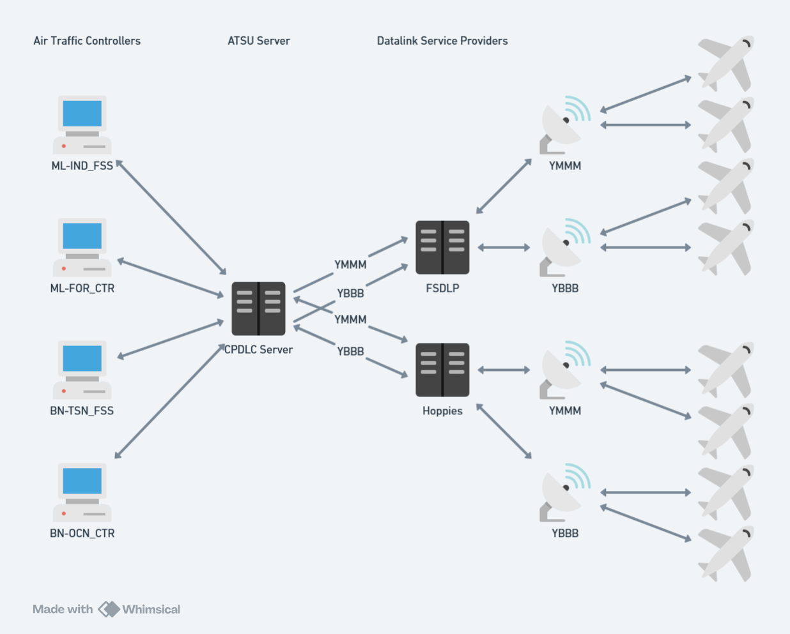

# CPDLC Server



The server maintains one or more connections to upstream ACARS networks (i.e. [Hoppies](https://www.hoppie.nl/acars/)).
Each connection simulates a single air traffic service unit (ATSU), such as Brisbane (YBBB) or Melbourne (YMMM).
The server will relay CPDLC messages to the upstream ACARS network, allowing pilots to connect to a single ATS unit and communicate with all enroute controllers within that unit.

The server also allows for multiple connections upstream ACARS networks, enabling ATC to communicate with aircraft on different ACARS networks (Hoppies, FSDLP, etc.) or aggregate messages across multiple ATSUs.

## Deployment

Deploy your own CPDLC Server instance to DigitalOcean:

[](https://cloud.digitalocean.com/apps/new?repo=https://github.com/YuKitsune/CPDLCPlugin/tree/main)

Since App Platform doesn't offer persistent disks, the template makes a PostgreSQL development database for the server data.

:::warning
You must set the `MasterKey` and `AuthType` environment variables before you deploy. With `AuthType=VATSIM`, you must also set `VatsimConnect__ClientId` and `VatsimConnect__ClientSecret`. If a required variable is not set, the server does not start.

Make a key with `openssl rand -base64 32`, and keep a copy in a safe place. See [Authentication](#authentication) for the two types.
:::

After deployment, open `/setup` on the server, and enter the first administrator and the operator details (see [Setup](#setup)). Then log in, and add your ACARS connection in Configuration → ACARS connections (`/configuration/acars`).

## Prerequisites

Before running the CPDLC Server, ensure you have:

- [.NET 10.0 SDK](https://dotnet.microsoft.com/download) or later (for local development)
- [Docker](https://www.docker.com/get-started) (for Docker deployment)
- A Hoppies ACARS account and logon code from [hoppie.nl](https://www.hoppie.nl/acars/system/register.html)

## Setup

When the server starts for the first time, it is not set up. All the pages of the dashboard redirect to the setup page (`/setup`).

On the setup page, enter:

- The VATSIM CID of the first administrator. With `AuthType=BuiltIn`, also enter the password of the administrator.
- The operator name: the person or organisation that operates the server, for example a VATSIM division or FIR.
- The privacy contact: an email address or a URL. Users use it to ask questions about their data, or to ask for their data to be deleted.

The privacy policy shows the operator name and the privacy contact. You can change them later in Configuration → Settings.

After the setup, the setup page does not exist. The administrator logs in, and can add more administrators in Configuration → Administrators.

:::warning
With `AuthType=VATSIM`, the setup page needs no login. The first person who opens it chooses the administrator. Do the setup immediately after the first start.

With `AuthType=BuiltIn`, the setup page needs a token. When the server starts and is not set up, it writes the setup URL with the token to its log. The server makes a new token each time that it starts.
:::

## Authentication

Set the `AuthType` environment variable to `BuiltIn` or `VATSIM`. If it is not set, the server does not start.

| | `BuiltIn` | `VATSIM` |
|---|---|---|
| CPDLC and ADS-C pages | No login | Log in with VATSIM |
| Administrators | Log in with their CID and a password | Log in with VATSIM |
| Plugin | The plugin sends the CID from vatSys. The server does not check it. | The controller logs in with VATSIM |

### BuiltIn

Only administrators log in, with their CID and a password of 12 characters or more. An administrator adds the other administrators, and gives them their first password, in Configuration → Administrators. Each administrator can change their password (Change password, at the bottom of the sidebar).

After 5 failed logins from one IP address, the login is locked for that IP address for 15 minutes.

The login page and the plugin authorize page accept 10 posts, or requests with a CID, a minute from each IP address, together.

:::warning
With `BuiltIn`, the server does not check the CID of the plugin. A controller can use any CID. Use `BuiltIn` only when you trust the users of the server.
:::

### VATSIM Connect

With `AuthType=VATSIM`, all users log in with [VATSIM Connect](https://vatsim.dev/services/connect). Make an OAuth client for the server at [auth.vatsim.net](https://auth.vatsim.net) (or [auth-dev.vatsim.net](https://auth-dev.vatsim.net) for development), with the redirect URL `https://<server>/signin-vatsim`. Then set these environment variables:

- `VatsimConnect__ClientId`: the ID of the client.
- `VatsimConnect__ClientSecret`: the secret of the client.
- `VatsimConnect__Authority` (optional): the VATSIM Connect server. The default is `https://auth.vatsim.net`.

Any VATSIM user can log in, open the CPDLC and ADS-C areas, and connect with the plugin. Only an administrator can open the Configuration area.

Behind a proxy that ends TLS, the server uses the `X-Forwarded-Proto` header, so that the redirect URL uses `https`.

### Plugin Authentication

The plugin must authenticate before it can connect to the server. In the SETUP window of the plugin, select **Authenticate**. The browser opens the server. With `VATSIM`, the user logs in with VATSIM. Then the user selects **Allow**, and the plugin gets a token. With `BuiltIn`, the plugin sends the CID from vatSys, and gets the token immediately. If vatSys has no CID, the user enters their CID, then selects **Allow**. The token is valid for 30 days. The plugin keeps it encrypted for the Windows account of the user.

One CID can have many tokens, for example one on each computer. Administrators see the tokens in Configuration → Plugin tokens (`/configuration/tokens`): the CID, and when each token was made, last used and expires. The page never shows the token itself. Administrators can search by CID, and delete one or more tokens. When a token is deleted, the plugin that uses it must authenticate again.

### Master Key

The master key encrypts the secrets in the database, for example the authentication codes of the ACARS connections. Set it in the `MasterKey` environment variable before the first start. You can make a key with `openssl rand -base64 32`, and keep a copy in a safe place.

If `MasterKey` is not set, or the key is not valid, the server does not start.

If the key is lost, the server cannot decrypt the secrets.

## Configuration

The logging level, the master key, the authentication, the data directory and the database are configured with environment variables. `MasterKey` and `AuthType` are required. With `AuthType=VATSIM`, `VatsimConnect__ClientId` and `VatsimConnect__ClientSecret` are also required.
For local development, copy `example.env` to `.env` and update with your settings:

```bash
# Logging
Logging__Level=Information

# Master Key (required)
# Encrypts the secrets in the database. Make a key with: openssl rand -base64 32
MasterKey=your-master-key

# Authentication (required): BuiltIn or VATSIM
AuthType=VATSIM

# VATSIM Connect (required when AuthType=VATSIM)
VatsimConnect__ClientId=your-client-id
VatsimConnect__ClientSecret=your-client-secret

# Data Directory
# The directory of the SQLite database (cpdlc.db) (default: /data)
DataPath=/data

# Database Configuration
# The database provider: Sqlite or PostgreSql (default: Sqlite)
DatabaseProvider=Sqlite
# PostgreSQL: the connection string. A URL (postgresql://...) is also accepted.
# DatabaseConnectionString=Host=localhost;Database=cpdlc;Username=cpdlc;Password=your-password
```

### Persistence

The server keeps the CPDLC connections, the dialogues, the ADS-C contracts, the ADS-C reports, settings, and the ACARS connections in a database.

The server can use SQLite or PostgreSQL (`DatabaseProvider`):

- **SQLite** (default): the database is the file `cpdlc.db` in the data directory (`DataPath`). In the Docker image, the data directory is the `/data` volume. For local development, it is the `.data` directory at the root of the repository.
- **PostgreSQL**: set `DatabaseConnectionString`. Use PostgreSQL when the platform has no persistent disk, for example DigitalOcean App Platform.

The server applies the migrations when it starts. With SQLite, it also makes the database file.

The server deletes a dialogue when the dialogue retention period ends (default: 24 hours). The period starts when the dialogue opens, not when the server starts. Thus, after a restart, the server deletes the dialogues that are older than the period within a few minutes. The server keeps the dialogues after the aircraft disconnects.

The server keeps only the latest ADS-C report for each contract. The report expires soon after the next periodic reports do not arrive (see [ADS-C](#ads-c)).

When a CPDLC connection ends, the server deletes the CPDLC message IDs of the aircraft. The next connection starts again at the first message ID.

### Concurrent Changes

The server processes the requests from controllers, the ACARS connections and the background tasks at the same time. Each changed record has a version. If two requests change the same record at the same time, the second request fails and the server runs it again with the new data, up to three times.

### ACARS Connections

The ACARS connections connect the server to the upstream ACARS networks. Add, change and delete them in Configuration → ACARS connections on the dashboard (`/configuration/acars`).

- When you add a connection, the server connects to the ACARS network.
- When you change a connection, the server will reconnect to the upstream ACARS network with the new settings.

You can add more than one connection, for example when the server serves more than one ATSU (YBBB and YMMM). Only one connection can use a station identifier.

The server keeps the authentication code of each connection encrypted with the master key (`MasterKey`). The dashboard does not show the code. If the master key changes, the server cannot decrypt the codes, and you must enter them again.

Each connection can have a message of the day. The server sends it to each aircraft as a CPDLC free text message, after the aircraft logs on and after the delay of the connection. The aircraft does not reply. The message shows in the dialogues, the same as the other uplinks.

The Traffic button of a connection shows the most recent requests to the ACARS network and their responses, as raw text. The server keeps the last 500 requests of each connection in memory. The authentication code is not shown. The Logs button shows the log of the connection.

:::note
`Hoppie` is currently the only supported ACARS network type.
:::

### Privacy Policy

VATSIM Connect needs a privacy policy and a statement that the service is not provided or endorsed by VATSIM. The server has both:

- The privacy policy is at `/privacy`. Everyone can open it, also without a login. It shows the operator, the privacy contact, the data that the server collects, who can see it, the third parties, and how long the server keeps the data. The retention times come from the settings, so the page is correct when you change them.
- Each page shows this statement, with a link to the privacy policy: "This server is a third-party service. It is not provided, operated or endorsed by VATSIM."
- The login page tells users that VATSIM gives the server their CID, and that they accept the privacy policy when they log in.

:::warning
The privacy policy describes the software. The operator is responsible for the data on their server. Read the policy, and make sure that it agrees with the laws that apply to you and with the VATSIM policies, before you open the server to users.
:::

### Branding

In the Branding section of Configuration → Settings, you can change the name of the server, add a banner image (PNG, JPEG or WebP, 1 MB or less), and add a message of the day. They show at the top of the sidebar and on the login page. The banner changes when you upload or remove it. The Save button saves the name and the message of the day.

### Logs

The Logs page of the dashboard (`/configuration/logs`) shows the live log of the server, with the same text and level colours as the console output.

You can show only the entries at or above a level, of one area (CPDLC, ADS-C, ACARS or System), of one ACARS connection, or with a text. You can also pause the log and clear the page. The filters are in the URL, so you can share a link to a filtered log. The logging level of the server (`Logging__Level`) sets which entries the server writes.

### ADS-C

When an aircraft logs on with CPDLC, the server requests the default ADS-C contract with the aircraft. When the CPDLC connection ends or is reset, the server cancels the contract.

:::note[VATSIM accommodation]
In real operations, ADS-C does not depend on CPDLC, and an ATSU usually keeps its ADS-C contract after a CPDLC transfer. Hoppie's network has no AFN logon, so the server uses the CPDLC connection as the signal that an aircraft is online.
:::

Each ATSU has its own default reporting interval, set on its ACARS connection. Controllers can read this value.

A controller can select a different reporting interval for an aircraft. The selected contract stays until a controller goes back to the default contract.

The aircraft does not acknowledge a request. The first report after a request accepts it. If the aircraft rejects a selected contract, the server requests the default contract again. If the aircraft rejects the default contract, the server does not send it again.

The server keeps one report for each contract. A new report replaces the previous report. When a controller connects, the plugin loads the latest report for each aircraft, so that the controller sees the ADS-C tracks immediately.

A report expires when the next two periodic reports do not arrive. The expiry time is two reporting intervals plus three minutes, from the time in the report. A contract with only a demand request uses the default reporting interval. When a report expires, or when its contract is removed, the server deletes the report and the plugin shows the flight plan track again.

The ADS-C area of the dashboard shows all the contracts and their states (`/adsc`), and a log of all the ADS-C messages that the server sent and received (`/adsc/messages`).

### ADS-C from VATSIM Status Data

Not all aircraft support ADS-C over Hoppie's network. When the "ADS-C from VATSIM status data" setting is on, the server fakes ADS-C reports using data from the [VATSIM status API](https://data.vatsim.net/v3/vatsim-data.json).

This is only done for aircraft that have `D1` or `G1` in Item 10b of the flight plan, unless the "allow aircraft without ADS-C equipment" setting is on. The server waits for the "report delay" after it makes a contract before it uses the VATSIM status data, so that the aircraft can send its first report through Hoppie. A report from Hoppie always has priority, and it stops the VATSIM reports for that contract. When the Hoppie report expires, the server uses the VATSIM status data again.

## Running

### Docker

```bash
docker-compose up
```

The server will be available at `http://localhost:5272`.

### Local Development

```bash
dotnet run --project source/CPDLCServer/CPDLCServer.csproj
```

The server will start on `http://localhost:5261`.
