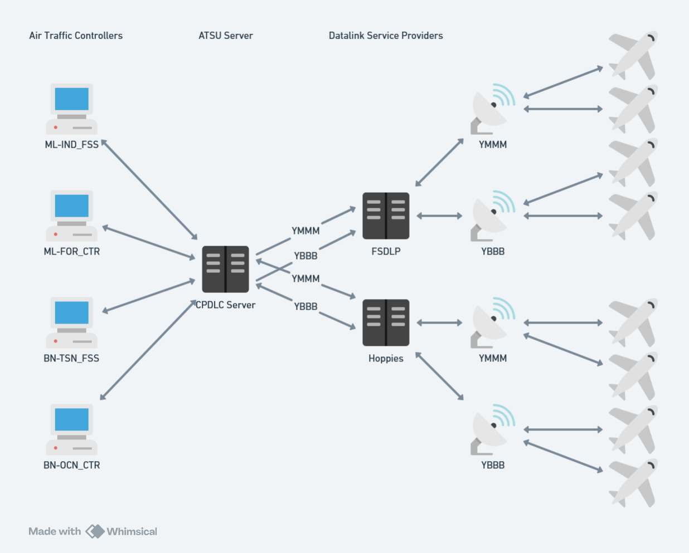

# CPDLC Server



The server maintains one or more connections to upstream ACARS networks (i.e. [Hoppies](https://www.hoppie.nl/acars/)).
Each connection simulates a single air traffic service unit (ATSU), such as Brisbane (YBBB) or Melbourne (YMMM).
The server will relay CPDLC messages to the upstream ACARS network, allowing pilots to connect to a single ATS unit and communicate with all enroute controllers within that unit.

The server also allows for multiple connections upstream ACARS networks, enabling ATC to communicate with aircraft on different ACARS networks (Hoppies, FSDLP, etc.) or aggregate messages across multiple ATSUs.

## Deployment

Deploy your own CPDLC Server instance to DigitalOcean:

[](https://cloud.digitalocean.com/apps/new?repo=https://github.com/YuKitsune/CPDLCPlugin/tree/main)

Since App Platform doesn't offer persistent disks, the template makes a PostgreSQL development database for the server data.

:::warning
You must set the `MasterKey` environment variable before you deploy. If `MasterKey` is not set, the server does not start.

Make a key with `openssl rand -base64 32`, and keep a copy in a safe place.
:::

After deployment, open the setup URL from the server log (see [Setup](#setup)). Then add your ACARS connection in Settings → ACARS on the server dashboard (`/settings/acars`).

## Prerequisites

Before running the CPDLC Server, ensure you have:

- [.NET 10.0 SDK](https://dotnet.microsoft.com/download) or later (for local development)
- [Docker](https://www.docker.com/get-started) (for Docker deployment)
- A Hoppies ACARS account and logon code from [hoppie.nl](https://www.hoppie.nl/acars/system/register.html)

## Setup

When the server starts for the first time, it is not set up. All the pages of the dashboard will redirect to the setup page. The server will write the setup URL to the log:

```
[12:00:00 WRN] The server is not set up. Open http://localhost:8080/setup?token=... to set it up
```

### Master Key

The master key encrypts the secrets in the database, for example the authentication codes of the ACARS connections. Set it in the `MasterKey` environment variable before the first start. You can make a key with `openssl rand -base64 32`, and keep a copy in a safe place.

If `MasterKey` is not set, or the key is not valid, the server does not start.

If the key is lost, the server cannot decrypt the secrets.

## Configuration

The logging level, the master key, the data directory and the database are configured with environment variables. Only `MasterKey` is required.
For local development, copy `example.env` to `.env` and update with your settings:

```bash
# Logging
Logging__Level=Information

# Master Key (required)
# Encrypts the secrets in the database. Make a key with: openssl rand -base64 32
MasterKey=your-master-key

# Data Directory
# The directory of the SQLite database (cpdlc.db) (default: /data)
DataPath=/data

# Database Configuration
# The database provider: Sqlite or PostgreSql (default: Sqlite)
DatabaseProvider=Sqlite
# PostgreSQL: the connection string. A URL (postgresql://...) is also accepted.
# DatabaseConnectionString=Host=localhost;Database=cpdlc;Username=cpdlc;Password=your-password
```

### Persistence

The server keeps the CPDLC connections, the dialogues, the ADS-C contracts, the ADS-C reports, settings, and the ACARS connections in a database.

The server can use SQLite or PostgreSQL (`DatabaseProvider`):

- **SQLite** (default): the database is the file `cpdlc.db` in the data directory (`DataPath`). In the Docker image, the data directory is the `/data` volume. For local development, it is the `.data` directory at the root of the repository.
- **PostgreSQL**: set `DatabaseConnectionString`. Use PostgreSQL when the platform has no persistent disk, for example DigitalOcean App Platform.

The server applies the migrations when it starts. With SQLite, it also makes the database file.

The server deletes dialogues 24 hours after they open. It deletes ADS-C reports after the configured ADS-C report retention period. These periods start when the dialogue opens or the report is received, not when the server starts. Thus, after a restart, the server immediately deletes the data that is older than the period.

### ACARS Connections

The ACARS connections connect the server to the upstream ACARS networks. Add, change and delete them in Settings → ACARS on the dashboard (`/settings/acars`).

- When you add a connection, the server connects to the ACARS network.
- When you change a connection, the server will reconnect to the upstream ACARS network with the new settings.

You can add more than one connection, for example when the server serves more than one ATSU (YBBB and YMMM). Only one connection can use a station identifier.

The server keeps the authentication code of each connection encrypted with the master key (`MasterKey`). The dashboard does not show the code. If the master key changes, the server cannot decrypt the codes, and you must enter them again.

:::note
`Hoppie` is currently the only supported ACARS network type.
:::

### Logs

The Logs page of the dashboard (`/logs`) shows the live log of the server, with the same text and level colours as the console output.

You can show only the entries at or above a level, pause the log, and clear the page. The logging level of the server (`Logging__Level`) sets which entries the server writes.

### ADS-C

When an aircraft logs on with CPDLC, the server requests the default ADS-C contract with the aircraft. When the CPDLC connection ends, the server cancels the contract.

Each ATSU has its own default reporting interval, set on its ACARS connection. Controllers can read this value.

A controller can select a different reporting interval for an aircraft. The selected contract ends after the selected ADS-C contract duration of the ACARS connection. Then the server requests the default contract again. A controller can also go back to the default contract at any time.

The aircraft does not acknowledge a request. The first report after a request accepts it. If the aircraft rejects a selected contract, the server requests the default contract again. If the aircraft rejects the default contract, the server does not send it again.

The server keeps a history of the reports for the ADS-C report retention period. When a controller connects, the plugin loads the latest report for each aircraft, so that the controller sees the ADS-C tracks immediately.

The ADS-C page of the dashboard (`/adsc`) shows all the contracts and their states, and a log of all the ADS-C messages that the server sent and received.

### ADS-C from VATSIM Status Data

Not all aircraft support ADS-C over Hoppie's network. When the "ADS-C from VATSIM status data" setting is on, the server fakes ADS-C reports using data from the [VATSIM status API](https://data.vatsim.net/v3/vatsim-data.json).

This is only done for aircraft that have `D1` or `G1` in Item 10b of the flight plan, unless the "allow aircraft without ADS-C equipment" setting is on. A report from Hoppie always has priority. If the Hoppie reports stop for more than two reporting intervals, the server uses the VATSIM status data again.

## Running

### Docker

```bash
docker-compose up
```

The server will be available at `http://localhost:5272`.

### Local Development

```bash
dotnet run --project source/CPDLCServer/CPDLCServer.csproj
```

The server will start on `http://localhost:5261`.
